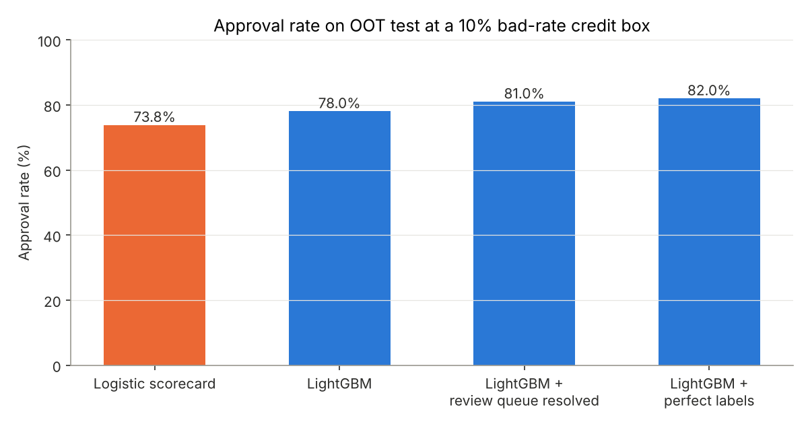
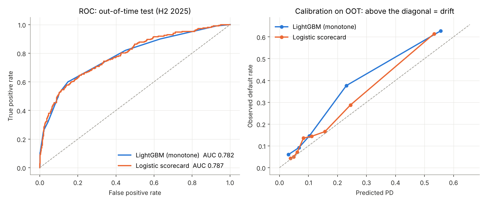
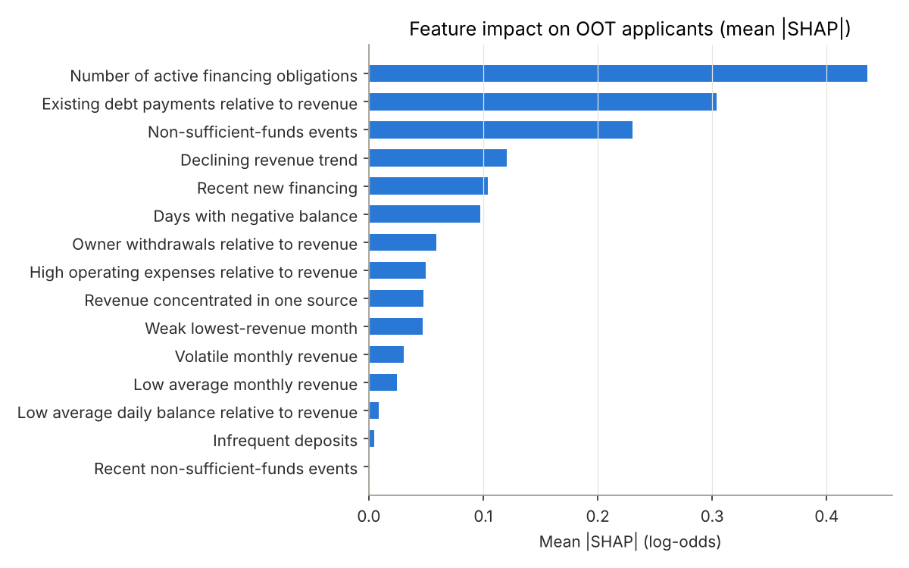

# SMB Cash-Flow Credit: from messy bank statements to an explainable PD model

An end-to-end small-business underwriting pipeline built on bank-transaction data:

1. **Synthetic bank statements** for 5,000 small businesses (1.29M transactions) across six industries, with realistic messiness: processor settlements, generic `ACH DEBIT … CCD` strings, unnamed wires, stacked MCA advances, overdrafts and transfers.
2. **A three-tier transaction classifier**: rules → ML → LLM, with a human-review queue.
3. **Cash-flow underwriting features**: true revenue, volatility, trend, liquidity, NSFs, stacking and debt-service burden.
4. **A monotone-constrained LightGBM PD model** with out-of-time validation, isotonic calibration and SHAP reason codes, benchmarked against a logistic scorecard.

The question it answers: **how much does transaction-classification quality matter for credit decisions?** It turns out to matter as much as the choice of model.

> All data is synthetic. A latent "health" score drives each business's cash flows and its default. The model never sees that score and must recover it from transactions, as a real cash-flow underwriter would.

---

## Headline results (out-of-time test: applications from H2 2025)



At a credit box that keeps the approved population at or under a **10% bad rate**:

| Model / feature quality | OOT AUC | KS | Approval rate |
|---|---|---|---|
| Logistic scorecard (same features) | 0.787 | 0.438 | 73.8% |
| **LightGBM, monotone constraints** | 0.782 | 0.453 | **78.0%** |
| LightGBM + low-confidence queue resolved (LLM or human) | 0.793 | 0.482 | 81.0% |
| LightGBM + perfect transaction labels (ceiling) | 0.808 | 0.509 | 82.0% |

What this shows:

- **AUC alone undersells the GBM.** The two models have near-identical AUC, but the GBM approves **4.2 points more applicants** at the same loss appetite. It captures the non-linear jump in risk once debt service passes ~20% of revenue, which is exactly where the cutoff decision sits. Judge models at the operating point, not only on rank-ordering.
- **Classification errors cost credit performance.** Only 4.6% of transactions fall below the confidence threshold. Resolving them recovers **+3.0 approval points** and +1.0 AUC point, about three-quarters of the gap to perfect labels. That is the business case for an LLM tier: a small fraction of transactions, concentrated in the categories that drive the model.
- **Drift is visible and expected.** The H2 2025 cohort carries a macro shift the training data never saw. Score PSI is low (0.014: the *population* didn't move) while observed defaults run 5.3 points above predicted. That is the signature of an outcome shift, not a population shift. Monitoring PSI alone would have missed it. The fix is recalibration on recent vintages, not a rebuild.



---

## 1. Transaction classification

| Tier | Share of transactions | Accuracy | Role |
|---|---|---|---|
| Rules (regex, sign-aware) | 23.3% | 100.0% | Unambiguous strings: payroll vendors, NSF fees, named lenders, transfers |
| ML (char n-gram TF-IDF + amount + recurrence → logistic regression) | 72.1% | 99.3% | Everything else above the confidence threshold |
| Low-confidence → LLM / review queue | 4.6% | 69.9% (ML guess) | Ambiguous strings: `ACH DEBIT 5724405242 CCD`, `WIRE IN 8812…` |

Trained on a "human-labeled" sample of 750 businesses and evaluated on the other 1.1M transactions: **98.1% overall, 99.5% outside the review queue.**

Design choices worth noting:

- **Recurrence context is the key feature.** A generic `ACH DEBIT … CCD` could be a supplier autopay or an unnamed MCA. What separates them is behavior: the MCA hits every business day for the same amount. The classifier sees how often each normalized pattern recurs in the statement and whether the amounts are identical.
- **Stricter thresholds for credit-critical categories** (revenue, lender payments, loan proceeds, transfers): 0.90 vs. 0.80. A misread lender payment distorts debt capacity far more than a misread office-supply purchase.
- **Recall on loan proceeds is the weak spot (78%).** Unnamed wires look identical whether they come from a funder or a large customer. In production this is where network data helps most: if another funder on the network just funded this business, the wire is almost certainly proceeds.
- **The LLM tier** (`smbcredit/classify.py`, `LLMClassifier`) sends the descriptor, amount and recurrence context to Claude and asks for structured JSON. It caches by normalized descriptor so each merchant string is paid for once. It switches on when `ANTHROPIC_API_KEY` is set. Without a key, those lines go to a human-review queue (`reports/review_queue_sample.csv`). The results above were produced offline, so the "queue resolved" row is the *upper bound* of what the LLM/human tier can recover.

Feature fidelity (correlation of features built from predicted vs. true categories) is lowest exactly where the business impact is: active funders (0.92) and recent new financing (0.87).

## 2. Cash-flow features

15 features in `smbcredit/features.py`, each tagged with its expected risk direction:

- **Revenue:** average monthly revenue, coefficient of variation, trend slope, weakest month vs. average
- **Expenses & liquidity:** operating expense ratio, relative average daily balance, days negative
- **Stress:** NSF count (total and last 30 days)
- **Debt & stacking:** active funders (distinct recurring payment streams in the last 30 days), lender payments / revenue, new funding in the last 90 days
- **Behavior:** owner draws / revenue, deposit frequency, revenue concentration

Only pre-application transactions are used (tested in `tests/`).

## 3. PD model

- **Out-of-time split:** train on 2024 applications (2,109), calibrate and early-stop on H1 2025 (1,026), test on H2 2025 (1,115). Never a random split for credit.
- **Monotone constraints** on every feature with a clear risk direction, so a higher NSF count can never lower the PD. This makes the model defensible to credit committees, bank partners and examiners, at little cost in accuracy.
- **Isotonic calibration** so outputs are usable as PDs for pricing and loss forecasting, not just ranks.
- **SHAP reason codes:** top three adverse factors per applicant, worded for adverse-action notices (see `reports/reason_codes_top25.csv`).



Debt stacking dominates: active funders, debt service relative to revenue and NSFs are the top three drivers. This matches what SMB funders see in practice.

---

## Run it

```bash
pip install -r requirements.txt
python run_pipeline.py                          # ~2 min; writes reports/
ANTHROPIC_API_KEY=sk-... python run_pipeline.py  # enables the LLM tier
pytest -q
```

```
smbcredit/
  generate.py   synthetic businesses, statements and outcomes
  classify.py   rules -> ML -> LLM hybrid classifier
  features.py   cash-flow underwriting features + monotone directions
  model.py      LightGBM PD, calibration, SHAP reason codes, scorecard benchmark
run_pipeline.py end-to-end run, metrics.json and charts
tests/          unit + end-to-end smoke tests
```

## What I'd do next with real network data

- **Entity resolution across funders**, so stacking is seen at application time from the network, not inferred from debits after the fact.
- **Leave-one-lender-out validation** and per-lender calibration layers, since funders define default differently.
- **An LGD model** (two-stage: probability of any recovery, then recovery rate) to complete expected-loss pricing.
- **Champion/challenger in production**, with monitoring that tracks calibration by vintage as well as PSI, since this project shows PSI can stay flat while the outcome shifts.
